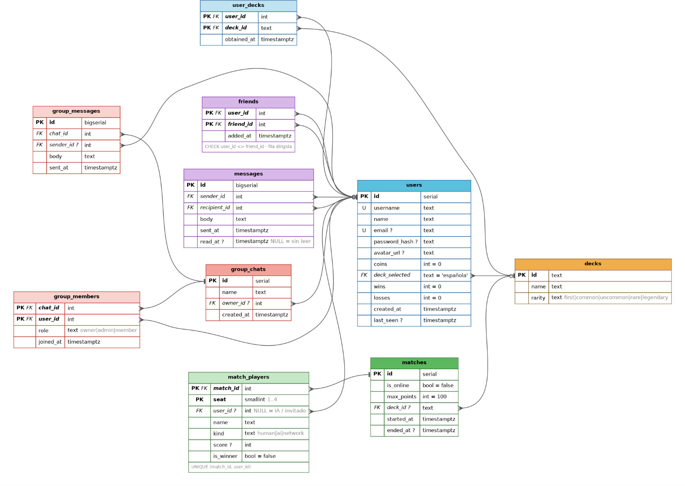

*This project has been created as part of the 42 curriculum by mignavar, dlopez-l, asaiz-lo, mcaro-ro and cde-migu. *

<p align="center">
  
</p>

# Description
Inspired by our own culture and traditions, we decided to make this final project of the 42 curriculum based in a game we love to play, specially in the sumer: Chinchon.

As is often the case with orally transmitted tradition, the rules for this game are different depending on who you ask. For this project we had to argue and then agree to the final rules.

**Chinchón** is a card game for 2 to 4 players using a Spanish deck of 40 or 80 cards (depending on the number of players), where the goal is to form combinations to have the lowest possible score and be the last player to exceed the limit of 100 points.

Each player is dealt 7 cards. On each turn, a players must draw a card from either the stock or the discard pile, and then discard another, trying to group their cards.

Valid combinations must have at least three cards:
- **runs**: consecutive cards of the same suit.
- **trios**: three or more cards of the same number.

To **close** the round, a player must have all their cards laid down, or lay down 6 cards with the seventh being a 3, 2, 1, or Ace. Closing with all cards laid down subtracts 10 points; closing with a single remaining card.

# Instructions

To play **Chinchon** you first need to deply the required files on a Linux operating system with an x86_64 architecture using Docker and Docker Compose. Before getting started, make sure your Docker installation is up to date. To do so, you can simply run the following commands in your terminal:
```
sudo apt update
curl -fsSL https://get.docker.com -o get-docker.sh
sudo sh get-docker.sh
sudo apt install docker-compose-plugin
``` 

Once Docker and Docker Compose are installed, clone the repository and run the Makefile, which will take care of both the build process and the deployment.

``` 
git clone https://github.com/mignavarl/chinchon_transcendence.git 

cd chinchon_transcendence

make
```

The Makefile first will create the SSL certificates and then will deploy the docekr environment to start all the services.

Once everything is running, you will see an output similar to the following:
```
[...]
All services are running
Game: https://<local_network_ip_address>:9443
API: <local_network_ip_address>:9443/api
[...]
```
Open https://<local_network_ip_address>:9443 in the web browser of any device connected to your local network and have fun!


# Team Information

This is a group project created by students from 42 Madrid. Meet the Chinchon Lovers!!

- **mignavar - Product Owner, Developer**
	Responsible for product planning, environment design and game development, deployment architecture and the game's graphics and artwork.

- **dlopez-l - Technical Lead, Developer**
	Responsible for the project's technical architecture, game development and deployment infrastructure.

- **mcaro-ro - Developer**
	Responsible for code reviews, quality assurance and front and backend development.

- **asaiz-lo - Developer**
	Responsible for backend development, database querys and quality assurance.

- **cde-migu - Developer**
	Responsible for project planning, multiplayer and frontend development, deployment architecture.

# Project Management

During our first team meetings, we decided to divide the project into two main areas:

Frontend (Game Experience and Multiplayer): responsible for developing the game in Godot and delivering a smooth multiplayer experience.
Backend (User Database, Authentication, and Security): responsible for building a robust backend, managing user data, and implementing user registration and authentication.
Once the team was divided into these two areas, we started organizing our work using GitHub Issues to track tasks and development milestones. We adopted a Git Flow workflow, creating a dedicated branch for every new feature before merging it into the main project.

Throughout the development process, we maintained continuous communication using mainly Whatsapp, while holding regular online meetings in person to discuss progress, resolve blockers, and coordinate the integration of each component.

# Technical Stack
For the frontend, we decided to develop a fully featured multiplayer card game that runs directly in modern web browsers. To achieve this, we chose Godot, an open-source game engine that provides all the tools needed to build a 3D anvironment and a 2D card game from the ground up.

In addition to its game development features, Godot includes a High-Level Multiplayer API, which greatly simplifies the implementation of multiplayer systems. To handle real-time communication between players, we chose WebSockets as the networking protocol, with a dedicated multiplayer server also developed in Godot.

For the backend, we chose Spring Boot as the main framework. It provides the REST API used by the web client to handle server-side functionality and persistent application data, including user management and database access. Spring Boot’s modular structure allows us to keep the backend logic well organized and separated from the game server, keeping responsibilities clearly divided between the web API and the real-time multiplayer service.

The backend is containerized using Docker, with the different services running independently and communicating through the appropriate network protocols. This architecture makes the application easier to deploy and maintain while allowing the game server and web API to scale or evolve independently.

# Database Schema

<p align="center">
	<a href="https://excalidraw.com/#json=UAMlRDNOquvo4NbqDjOYc,-5DIA0vtVQM5K_-HXFhlPg">
  		
	</a>
</p>


# Features List
- **Full single-player experience**. Play Chinchón against an AI opponent

- **Full multiplayer experience**. Challenge your friends in exciting matches.

- **Avatar customization**. Choose from a wide collection of ourlovable villagers.

- **3D menu environment**. Fall in love with this charming corner of our little village, where you can choose to play or to obtain more decks.

- **2D card gameplay**. A dedicated table view where the matches take place.

- **Deck collection**. Unlock, collect and equip different card decks with unique designs.

- **Multiple language support**. Play the game in Spanish, Catalan or Basque.

- **Containerized backend services**. Springboot API and supporting services can be deployed independently using Docker.

- **Stored player data**. Store and manage player accounts, profiles, and game-related data through the backend.

# Modules

## Web

### Major

- **Use a framework for both the frontend and backend**. Godot Engine is used as the frontend framework for the game, while Springboot is used as the backend framework for the API and server-side functionality.

- **Allow users to interact with other users**. We implement a basic system where you can view user info and add/remove friends from a list. 

- **Implement real-time features using WebSockets or similar technology**: Real-time multiplayer communication using WebSockets through Godot's High-Level Multiplayer API. 
 
- **A public API to interact with the database with a secured API key, rate limiting, documentation, and at least 5 endpoints**. The project includes a REST API that provides controlled access to persistent application data through multiple endpoints. API access is protected through authentication mechanisms, with rate limiting applied to prevent abuse. The API is documented to make its endpoints and expected requests easier to understand and consume.

### Minor

- **Custom-made design system with reusable components, including a proper color palette, typography and icons**

- **File upload and management system**.

## Accesibility and Internationalization

### Minor
- **Support for multiple languages (at least 3 languages)**. We have translated our project to catalan and euskera, since this is mainly a spanish game.

- **Support for additional browsers**: Compatibility with Google Chrome, Mozilla Firefox.

## User Management

### Major

- **Standard user management and authentication**. Users can update their information, upload an avatar or choose from our defaults, add friends and see their online status and have access to their personal info page.

### Minor

- **Game statistics and match history**: track iser game statistics, display match history, show achievements and progrssions, with an integrated leaderboard.

## Artificial Intelligence

### Major
- **Introduce AI Opponents for games**. The opponent uses a deterministic decision-making system with controlled variation. Its actions are selected according to the current game state and available cards, giving it consistent behavior while introducing enough randomness to prevent every match from playing out identically.

## Gaming and User Experience

### Major
- **Implement a complete web-based game where users can play against each other**: Complete multiplayer gameplay implemented with Godot's frontend and High-Level Multiplayer API over WebSockets.

- **Remote players - Enable players on separate computers to play the same game in real-time**: Room-based multiplayer system allowing up to four players on different computers to play in real time over the same local network.

- **Multiplayer game (more than two players)**. We support up to 4 players simultaneously with proper synchronization across all clients.

- **Implement advanced 3D graphics using a library like Three.js or Babylon.js**. We created an immersive 3D environment implementing advanced rendering techniques and ensuring smooth performance and user interaction.

### Minor
- **Game cutomization options**. User can choose different card decks and number of AI opponents in the single player mode.

## Point Calculation

- **Major modules**: 10 (20 points).
- **Minor modules**: 6 (6 points).

**Total: 26 points**.

# Individual Contributions
- **mcaro-ro**. Backend development, gameplay programming, API design, code reviews and quality assurance.

- **dlopez-l**. Technical leadership, gameplay programming, multiplayer systems, deployment architecture, built automation.

- **asaiz-lo**. Backend architecture and database integration, REST API development, authenticaation and quality assurance.

- **mignavar**. Product Ownership, frontend development, UI/UX design, 3D and 2D assets and graphics and gameplay design.

- **cde-migu**. Project management, gameplay programming, code reviews, internationalization and code reviews. 

# Resources

## Frontend

### Documentation

- [Godot Docs](https://docs.godotengine.org/en/stable/#)
- [Exporting for the Web - Godot Docs](https://docs.godotengine.org/en/stable/tutorials/export/exporting_for_web.html)

### Tutorials
- [Card Game Godot 4.3 COMPLETE TUTORIAL - Barry's Dev Hell (playlist)](https://www.youtube.com/playlist?list=PLNWIwxsLZ-LMYzxHlVb7v5Xo5KaUV7Tq1)
- [Dedicated Multiplayer - Game Development Center (playlist)](https://www.youtube.com/playlist?list=PLZ-54sd-DMAKU8Neo5KsVmq8KtoDkfi4s)

### Videos
[Godot Multiplayer Tutorial: The Quick and Easy High-Level API - IcyEngine](https://www.youtube.com/watch?v=YnfsyZJRsL8)

## Backend

### Articles

- [WebSocket and Its Difference from HTTP](https://www.geeksforgeeks.org/web-tech/what-is-web-socket-and-how-it-is-different-from-the-http/)

- [WebSocket Explained: What It Is and How It Works](https://medium.com/@omargoher/websocket-explained-what-it-is-and-how-it-works-b9eafefe28d7)

### Documentation

- [RFC 6455 - The WebSocket Protocol](https://datatracker.ietf.org/doc/html/rfc6455)
- [MDN - WebSocket](https://datatracker.ietf.org/doc/html/rfc6455)
- [Godot Docs - Using WebSockets](https://docs.godotengine.org/en/stable/tutorials/networking/websocket.html)
- [Springboot Docs](https://docs.spring.io/spring-boot/documentation.html)
- [Spring Rest Framework Authentication Docs](https://springframework.guru/spring-rest-docs/)
- [Dockerizing a Spring Boot application](https://www.baeldung.com/dockerizing-spring-boot-application)
### Videos
[Godot High Level Multiplayer and WebSockets connection - Davies dev](https://www.youtube.com/watch?v=RQKodnluOp8&list=PLylNHWOqRhsGCmeOcKOPnbMRKSNqqQycM)

[How to create a REST API in Spring Boot using Java - Daniel Smidstrup](https://www.youtube.com/watch?v=Zo9xQzibp4Y)

## AI Usage
We tried to keep AI usage to a minimum in order to strengthen our programming skills and critical thinking. At the same time, we recognize that AI is a valuable tool that, when used responsibly, can improve productivity and accelerate development.

Throughout the project, we aimed to strike a balance between the practical benefits of AI and its ethical implications. We are aware of the ongoing discussions surrounding its environmental impact, its effects on creative industries, and the unresolved legal questions regarding copyright and training data. These topics continue to evolve and deserve careful consideration.

For this reason, we limited AI assistance to technical and documentation-related tasks, including:

- Researching information about frontend and backend deployment, as well as the technologies used in this project (Godot, Springboot, Docker, WebSockets, etc.).
- Reviewing and refactoring code during different stages of development.
- Assisting with small, well-defined pieces of code, particularly for deployment scripts and parts of the WebSocket networking architecture.
- Improving spelling, grammar, and technical documentation.

No AI-generated assets were used in the production of the game's artwork or graphics. Every visual and audio asset included in Chinchon was created or selected by the team without the use of generative AI.
